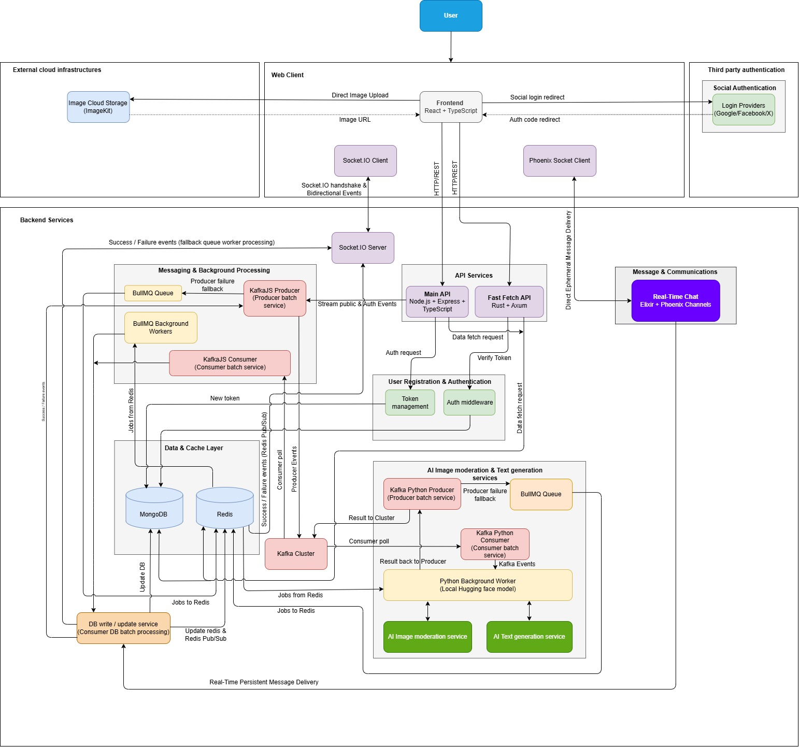

# Main Architecture

The project follows a multi-service backend architecture.

Different services are responsible for different tasks, such as API handling, fast data fetching, real-time communication, and AI processing.

  

<h2><b> *More details will be added as the documentation progresses.* </b></h2>

