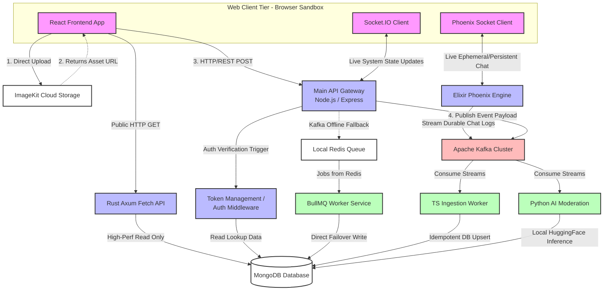

# Main Architecture

The project follows a multi-service backend architecture.

Different services are responsible for different tasks, such as API handling, fast data fetching, real-time communication, and AI processing.
```  
                         MyBlog
                           |
                    React Frontend
                           |
                    API Communication
                           |
                    Node.js / Express
                           |
        ┌──────────────────┼───────────────────────────────────────┐
        |                  |                  |                    |
        |                 Kafka               Redis               BullMq
        |                  |                  |                    |
        |              Event Messaging       Cache            Background Queue processing
        |                  |                 
    ┌───|                  |
    ┌──────────────────────┴─────────────────┐
    |                      |                 |
  MongoDB              Python AI        Other Services
    |                  Moderation            |
Persistent                                   |   
Storage                             Rust Axum API, Elixir Phoenix Chat
```

<h2><b> *More details will be added as the documentation progresses.* </b></h2>




